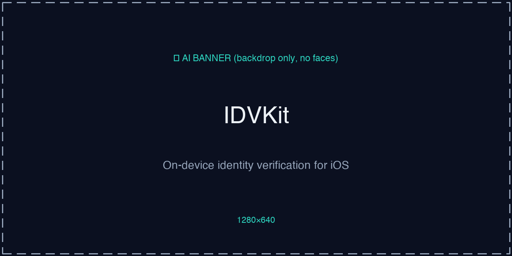
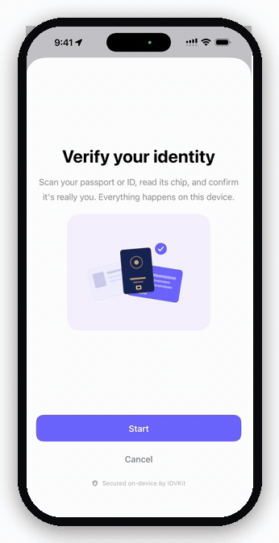
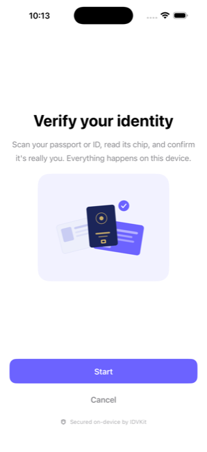
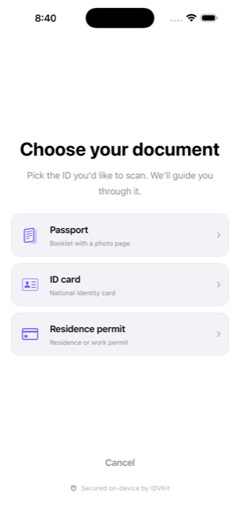
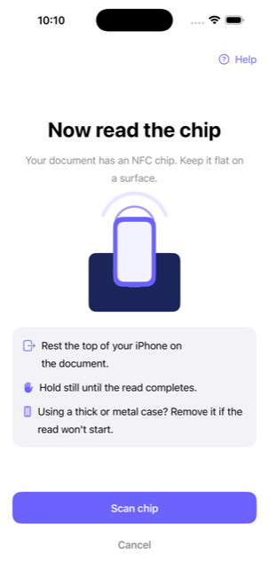
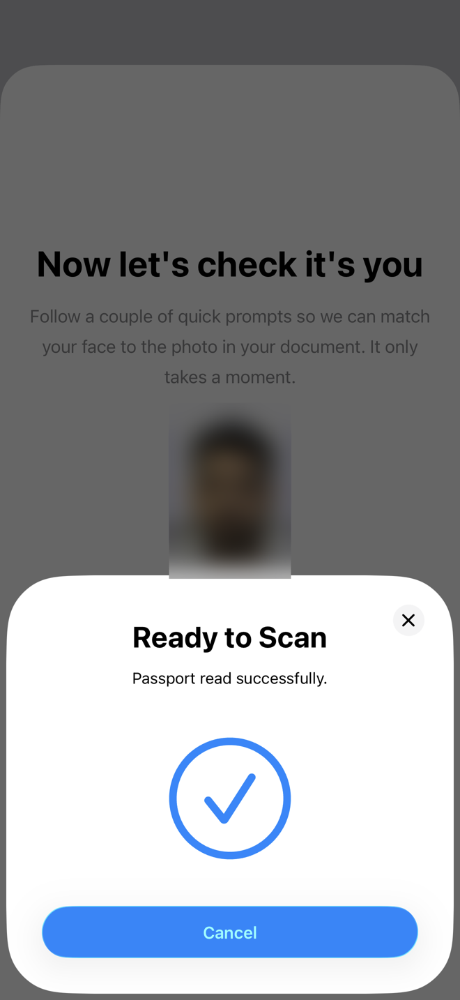
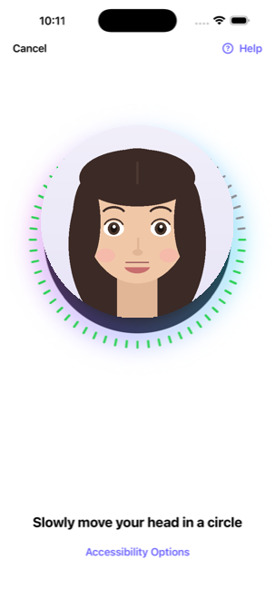
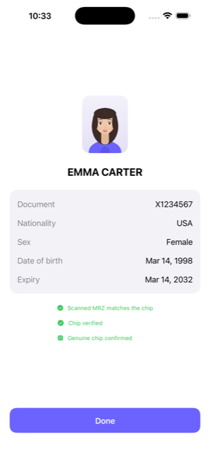
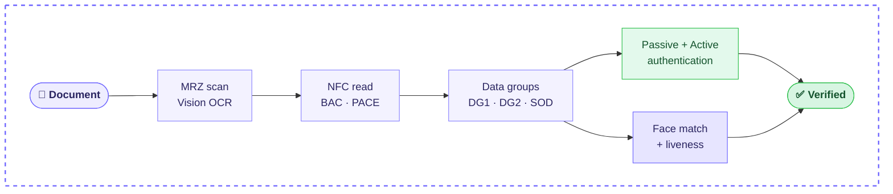

<!--
  README graphics: placeholder images live in Assets/readme/ so you can see the
  layout now. Replace each with the real asset (see Assets/readme/ASSETS.md for the
  shopping list). Real screen recordings only for anything showing a face/NFC —
  never an AI-generated human face.
-->

<div align="center">



<!-- Badges -->
[](https://swift.org/package-manager/)
[](https://developer.apple.com/ios/)
[](https://swift.org)
[](https://github.com/masadchattha/IDVKit/actions/workflows/ci.yml)
[](LICENSE)


### Read a passport or ID's NFC chip, prove it's authentic, and match the holder's face — 100% on the device.

**IDVKit** is the open-source **Onfido / Persona / Veriff alternative** for iOS: eMRTD chip reading (BAC · PACE · passive **and** active authentication), MRZ scanning, MobileFaceNet face match, and ARKit liveness — with **no servers, no API keys, and no per-verification fees.** Every byte stays on the phone.

`NFC eMRTD`&nbsp; `BAC / PACE`&nbsp; `Passive + Active auth`&nbsp; `MRZ OCR`&nbsp; `Face match`&nbsp; `Liveness`&nbsp; `Swift 6`&nbsp; `iOS 18+`



</div>

> ⚠️ **Status: pre-release (`0.1.0-dev`).** The full pipeline — document scan, NFC chip read, passive + active authentication, and face match + liveness — is implemented and validated on device. Before shipping in a **commercial, public** product, confirm the bundled face-embedding model's license (see [`Sources/IDVKitFace/Resources/README.md`](Sources/IDVKitFace/Resources/README.md)).

## Contents

- [Why IDVKit](#why-idvkit)
- [Features](#features)
- [Which module do I need?](#which-module-do-i-need)
- [See it in action](#see-it-in-action)
- [Requirements](#requirements)
- [Installation](#installation)
- [Quick start](#quick-start)
- [Use a single module](#use-a-single-module)
- [Chip authenticity (passive authentication)](#chip-authenticity-passive-authentication)
- [How it works](#how-it-works)
- [Known limitations](#known-limitations-being-honest)
- [API conventions](#api-conventions)
- [License](#license)

## Why IDVKit

Commercial identity-verification SDKs charge per verification and upload your user's document and face to their cloud. IDVKit does the same job **entirely on the device** — and you can read every line of code that touches the data.

| | Onfido / Persona / Veriff | AndyQ/NFCPassportReader | **IDVKit** |
|---|:---:|:---:|:---:|
| Price | ~$1–3 / verification | Free | **Free (MIT)** |
| Data leaves the device | ☁️ Uploaded to vendor cloud | On-device | **Never leaves** |
| API key / account | Required | None | **None** |
| NFC chip reading (passport · ID · permit) | ✅ | ✅ | **✅** |
| Chip **integrity** (SOD hashes + signature) | ✅ | ✅ | **✅** |
| Chip **chain of trust** (CSCA) | ✅ | ⚠️ manual | **✅** |
| Active / Chip auth (anti-clone) | ✅ | ⚠️ partial | **✅** |
| MRZ camera scan | ✅ | ✗ | **✅** |
| Face match + liveness | ✅ | ✗ | **✅** |
| JPEG2000 chip-photo decode (DG2) | ✅ | ⚠️ historically weak | **✅ OpenJPEG 2.5.4, vendored** |
| Source | Closed | Open | **Open — audit it** |

## Features

#### 🛂 &nbsp;NFC document-chip reading — from scratch, no third-party NFC library

Passport (TD3), national **ID card** and **residence permit** (TD1/TD2); the layout is auto-detected. BER-TLV, ISO 7816-4 APDUs, data-group parsing, and **both access protocols**:

- **BAC** (3DES) — validated byte-for-byte against the ICAO Doc 9303 **Appendix D** worked example
- **PACE** (ECDH Generic Mapping, AES) — hand-written brainpool/NIST elliptic-curve math (Apple's crypto can't do brainpool), validated against the **Appendix G** worked example
- `.automatic` mode prefers PACE and falls back to BAC

#### ✅ &nbsp;Passive authentication, split honestly

**Data integrity** (every DG hash matches the SOD, and the SOD signature is valid — no trust store needed) and **chain of trust** (the Document Signer chains to a CSCA you supply) are reported **separately** (`dataIntegrity` / `chainOfTrust`) — so an app without a CSCA store still learns whether the data is intact. Built on Apple's `swift-certificates` / `swift-asn1`, no networking.

#### 🛡 &nbsp;Active / Chip Authentication (anti-clone)

Proves the physical chip is the original, not a copy (RSA ISO 9796-2 recovery + brainpool/NIST ECDSA).

#### 🔍 &nbsp;MRZ camera scan

Apple Vision OCR, ICAO 9303 check-digit validation on every frame — no Tesseract.

#### 🖼 &nbsp;JPEG2000 decoding

OpenJPEG 2.5.4 compiled from vendored source — device, simulator and Catalyst. (The chip portrait in DG2 is JPEG2000; most readers handle it poorly.)

#### 🙂 &nbsp;Face match

MobileFaceNet CoreML, ArcFace 5-point alignment, cosine similarity with a configurable threshold — returns the score, never a bare pass/fail.

#### 👁 &nbsp;Active liveness

ARKit blend-shape challenges (blink / smile / open mouth / head turn), micro-movement anti-spoofing, and multiple-face rejection.

#### 🎨 &nbsp;Drop-in SwiftUI flow

Themeable (`IDVTheme`), brandable with your app icon and name (`IDVBrandingConfiguration`), customizable Apple NFC-sheet text — or go fully headless.

#### 🧩 &nbsp;Modular

Take the whole flow, or one brick (NFC / MRZ / face) — each module stands alone.

#### 🔒 &nbsp;Zero networking code in the package

Grep it — the privacy promise is auditable.

## Which module do I need?

Take the umbrella for everything, or import just the brick you need — each module stands alone.

| You need… | Import | It's a… |
|---|---|---|
| 🪪 **Full KYC flow** (scan → chip → face), drop-in UI | `IDVKit` | complete flow |
| 📖 **Read & authenticate an NFC document chip** | `IDVKitNFC` | headless reader |
| 🔍 **Scan & validate an MRZ** | `IDVKitMRZ` | headless scanner (or `IDVMRZScannerView`) |
| 🙂 **Match two faces + liveness** (any images) | `IDVKitFace` | headless matcher |
| 🖼 **Decode a JPEG2000 image** | `IDVKitJPEG2000` | decoder |

```swift
// Pick exactly what you need in Package.swift:
.product(name: "IDVKit",     package: "IDVKit"),   // everything
.product(name: "IDVKitNFC",  package: "IDVKit"),   // just the chip reader
.product(name: "IDVKitMRZ",  package: "IDVKit"),   // just the MRZ scanner
.product(name: "IDVKitFace", package: "IDVKit"),   // just face match + liveness
```

## See it in action

The whole flow, captured live from the running app:

| | | |
|:---:|:---:|:---:|
|  |  |  |
| **Guided intro** | **Pick your document** | **Read the NFC chip** |
|  |  |  |
| **Chip read ✓** | **Liveness capture** | **Verified ✓** |

<sub>Demo data is fake specimen data (EMMA CARTER / USA); the demo portrait is an illustration, not a real person. The MRZ camera scan and the "chip read ✓" moment are device-only states — the full live run is in the demo GIF at the top.</sub>

## Requirements

| | |
|---|---|
| Platform | **iOS 18+** (the bundled face-embedding CoreML model targets iOS 18) |
| Language | Swift 6, strict concurrency, async/await |
| NFC | A physical device (iPhone 7+). The Simulator can't read chips — use `IDVMockPassportReader`. |
| Face scan | Any A12-or-newer device (all iOS 18 devices); TrueDepth **not** required |

A Swift package cannot declare entitlements — your app must add:

1. **Capability:** Near Field Communication Tag Reading
2. **Entitlement:** `com.apple.developer.nfc.readersession.formats` = `["TAG"]`
3. **Info.plist:**
   - `com.apple.developer.nfc.readersession.iso7816.select-identifiers` = `["A0000002471001", "A0000002472001", "00000000000000"]`
   - `NFCReaderUsageDescription`
   - `NSCameraUsageDescription` (also covers the face scan)

See [`Examples/IDVKitExample`](Examples/IDVKitExample) for a complete, runnable integration.

## Installation

### Swift Package Manager

In Xcode: **File → Add Package Dependencies…** and enter:

```
https://github.com/masadchattha/IDVKit
```

<details>
<summary>Or add it to <code>Package.swift</code></summary>

```swift
dependencies: [
    .package(url: "https://github.com/masadchattha/IDVKit", from: "0.1.0")
]
```
</details>

<details>
<summary>Carthage / CocoaPods</summary>

Prebuilt `IDVKit.xcframework` bundles will be attached to GitHub releases from `0.1.0`. Until then, SPM is the supported path.
</details>

## Quick start

### Drop-in flow (SwiftUI)

```swift
import IDVKit

.sheet(isPresented: $showVerification) {
    IDVVerificationFlowView { result in
        if case .verified(let outcome) = result {
            print(outcome.document.mrz.surname, outcome.faceMatch?.similarity)
        }
    }
    .idvTheme(MyBrandTheme())   // optional — colors, fonts, shape
}
```

### What you get back

`IDVVerificationResult` is `.verified(IDVVerificationOutcome)`, `.failed(IDVError)`, or `.cancelled`. The outcome carries everything, on-device:

```swift
outcome.document.mrz              // IDVMRZData — name, doc number, DOB, expiry, nationality…
outcome.document.faceImageData    // the chip portrait (DG2), JPEG
outcome.document.dataGroupsRead   // which data groups were read
outcome.document.authenticity     // IDVChipAuthenticityResult:
//   .passiveAuthentication.dataIntegrity   — hashes + SOD signature valid
//   .passiveAuthentication.chainOfTrust    — DSC chains to a trusted CSCA
//   .activeAuthentication                  — chip is genuine (anti-clone)
outcome.liveness                  // IDVLivenessOutcome? — challenges passed
outcome.faceMatch                 // IDVFaceMatchResult? — isMatch, similarity, both images
```

Every status is an explicit `.passed / .failed(reason:) / .notPerformed(reason:) / .notSupportedByChip` — never a silent boolean.

### Brand it as yours

```swift
var config = IDVConfiguration.default
config.ui.branding = IDVBrandingConfiguration(
    logoImageData: UIImage(named: "AppIcon")?.pngData(),
    appName: "Acme"
)
```

Let the user pick a document type before scanning (a picker appears automatically when you allow two or more kinds):

```swift
var config = IDVConfiguration.default
config.mrz.allowedDocuments = [.passport, .idCard, .residencePermit]
```

## Use a single module

**Just MRZ scanning:**

```swift
import IDVKitMRZ

IDVMRZScannerView { mrz in
    print(mrz.documentNumber, mrz.surname)   // checksum-valid, guaranteed
} onError: { error in ... }
```

**Just NFC chip reading (headless):**

```swift
import IDVKitNFC

let key = IDVMRZKey(documentNumber: "…", birthDate: "…", expiryDate: "…")
let passport = try await IDVPassportReader().read(mrzKey: key)
print(passport.mrz.surname, passport.authenticity.passiveAuthentication.dataIntegrity)
```

**Just face match + liveness (any two images):**

```swift
import IDVKitFace

let result = try IDVFaceMatcher().match(reference: passportPhoto, live: selfie)
print(result.isMatch, result.similarity)
```

**Just decode a DG2 JPEG2000 image:**

```swift
import IDVKitJPEG2000

let cgImage = try IDVJPEG2000Decoder.decode(dg2ImageData)   // throws, never crashes
```

### Logging

Silent by default. Opt in during development:

```swift
IDVLog.isEnabled = true   // unified logging, subsystem "dev.idvkit"
```

Biometric data, document fields and similarity scores are never logged.

## Chip authenticity (passive authentication)

Supply your own CSCA trust anchors to get the full chain-of-trust check:

```swift
let store = try IDVTrustStore(pemFileURL: myCSCABundleURL)   // or IDVTrustStore(pem:) / (certificatesDER:)
var config = IDVConfiguration.default
config.nfc.passiveAuthentication = .enabled(cscaTrustStore: store)

let passport = try await IDVPassportReader(configuration: config.nfc).read(mrzKey: key)
let pa = passport.authenticity.passiveAuthentication
pa.dataIntegrity    // hashes match + SOD signature valid (no trust store needed)
pa.chainOfTrust     // DSC chains to a trusted CSCA (needs the store)
pa.isFullyVerified  // both passed
```

CSCA certificates are public government credentials. IDVKit does **not** bundle a master list — ICAO's trust model expects you to establish CSCA trust yourself, and a frozen snapshot silently rejects newer documents. Get an up-to-date list from the [ICAO PKD](https://download.pkd.icao.int) or the German BSI master list, and refresh it periodically.

## How it works

Every step runs on the device — nothing is uploaded.



> 🔒 The dashed indigo box is the device boundary — **every step runs on-device; nothing crosses it.**

## Known limitations (being honest)

- **Passive authentication proves data authenticity, not that *this* chip is the original** — a clone passes it. Clone detection is **Active / Chip Authentication**, which IDVKit implements (`authenticity.activeAuthentication`); check it, not just passive auth, when clone resistance matters.
- **RSA-PSS** Document Signer Certificates *are* verified (via `_CryptoExtras`) for the standard profile (MGF1 hash = signature hash, salt = digest length). A non-standard PSS salt length or MGF1 hash is reported honestly as unverified. **ECDSA-SHA1** DSCs are not yet verifiable.
- **Brainpool elliptic curves** are supported for **PACE** (hand-written EC math), but a DSC with a brainpool *public key* is not verifiable for passive auth (Apple crypto limitation); documented gap.
- **No CRL/revocation checking** — typical for mobile readers; stated per ICAO's requirement.

## API conventions

- All public types carry the `IDV` prefix (`IDVPassportReader`, `IDVMRZScannerView`, `IDVError`, …) so nothing ever collides with your code or Apple frameworks.
- Everything not meant for integrators is `internal`/`package` — the public surface is the contract, and it follows SemVer.
- Every failure is a typed `IDVError`; the SDK never calls `fatalError`.
- Swift 6, strict concurrency, async/await, iOS 18+.

## License

MIT — see [LICENSE](LICENSE). Vendored OpenJPEG is BSD-2-Clause (`Sources/COpenJPEG/LICENSE`). Attributions in [NOTICE](NOTICE).
